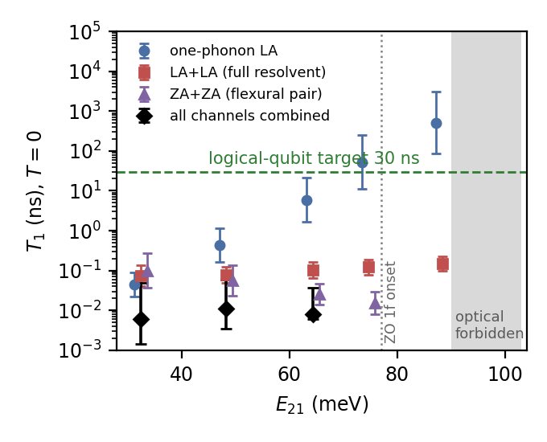
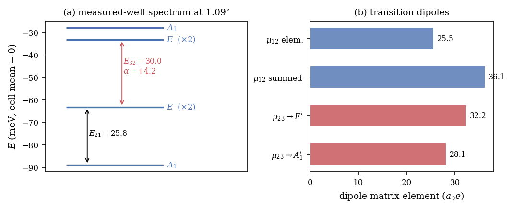
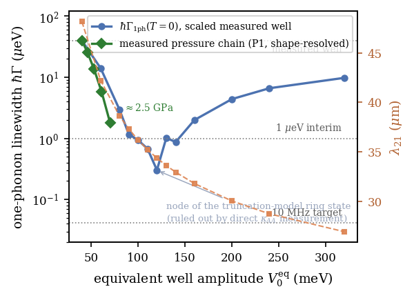

# Why twisted-hBN moiré artificial atoms cannot host orbital qubits

**Status:** Manuscript in preparation (negative result). Only an extended abstract is included (`paper/ABSTRACT.md`).

Author: Faruk Sami Bilgin, Independent Researcher, ORCID [0009-0001-9064-4410](https://orcid.org/0009-0001-9064-4410)

## Question

The companion preprint ([repo](https://github.com/FarukSamiBilgin/twisted-hbn-artificial-atoms),
doi:[10.5281/zenodo.24201814](https://doi.org/10.5281/zenodo.24201814)) measured the twisted-hBN moiré potential by
registry-resolved DFT (V0_eq = 40 meV, level spacing E21 = 32.4 meV at 1.09° in the four-star fit). Here: can the
intra-well orbital transition be engineered into a qubit with T1 ≥ 30 ns (logical-qubit target)?

## Method

DFT deepening campaign on the same registry map (pressure / gap closure, trilayer, strain, perpendicular field,
AA curvature scan, corrugation under pressure), then a zero-temperature all-channel phonon relaxation budget:
one-phonon LA (deformation, piezoelectric, pseudo-gauge, registry vertices), LA+LA with the full intermediate-state
resolvent, flexural ZA+ZA pairs, sequential two-phonon processes and contact terms; two independent implementations
plus an LA+LA cross-check; and a calibration of the same model class on the Si:P 2p0 lifetime.

## Key results



Combined T1 (`results/combined_verdict_hukum.json`, central / pessimistic / optimistic):

| E21 (meV) | T1 central | band | ħΓ central | shortfall vs 30 ns (central / optimistic) |
|---|---|---|---|---|
| 32 (measured well) | 5.9 ps | 1.4–50.4 ps | 111.3 µeV | 5071× / 595× |
| 48 (3 GPa) | 11.3 ps | 3.4–57.4 ps | 58.1 µeV | 2649× / 523× |
| 64 (5 GPa, extrapolated) | 7.9 ps | 6.0–33.9 ps | 83.7 µeV | 3815× / 886× |

- Two-phonon emission (LA+LA near q0/2; flexural pairs at nearly zero net momentum) is not form-factor protected and
  sets a floor of order 10 ps that deepening does not move; one-phonon LA alone rises to ≥ 87 ns at 88 meV
  (`results/floor_channels_taban_kanallar.json`).
- No lever reaches the target: 30 ns would need a deformation potential D ≲ 0.9–1.1 eV (computed band 3.66–5.94 eV);
  all levers combined give T1 ~ 1 ns at best (≥ 30× short).
- Measured deepening: pressure λ_V0 ≈ 0.70–0.80 Å, E21 32.4 → 48.2 meV at 3 GPa; trilayer ×1.41; strain and field do
  not deepen; gap corrugation saturates at 0.212–0.218 Å (5–15 GPa).
- Si:P calibration: real-tail model 1.08 ns vs measured 205 ± 18 ps; a Gaussian envelope of equal second moments
  lengthens it by ~3×10¹³ (`results/sip_calibration_scan.json`). A one-phonon T1 is an upper bound.

| | |
|---|---|
|  |  |

**Negative result, plainly:** the orbital transition of the twisted-hBN AA well cannot be made into a logical qubit by
any knob available in this host. An earlier internal draft concluded the opposite; it rested on a one-phonon budget
and on an LA+LA estimate with two errors (missing identical-boson factor 1/2; sum truncated at ten states). The
corrected cross-check is in `scripts/t1/cross_check/` (`results/la_la_convergence_check.json`).

## How the results were verified

Two independent all-channel implementations (finite-difference and plane-wave well solvers, sparse-LU resolvent);
a third LA+LA code on the companion solver (agrees with the ten-state value at 88.4 meV to 1.4%); intermediate-state
convergence scan (10/20/40 states and full resolvent); solver self-tests (`scripts/t1/all_channel/data/test_cozucu.json`);
dedicated PBE deformation-potential runs (`*_nscf.out`); calibration against a measured system (Si:P).

## Repository layout

- `paper/ABSTRACT.md` – extended abstract.
- `figures/` – manuscript figures (PNG/PDF).
- `results/` – headline result files (copies of the files generated inside `scripts/`).
- `scripts/t1/all_channel/` – one- and two-phonon channels (`kod/` code, `data/` outputs incl. PBE deformation-potential outputs).
- `scripts/t1/resolvent/` – LA+LA and ZA+ZA with full resolvent (`za_za` inside `iki_fonon_hakem.py` is superseded by `za_tablo.py`).
- `scripts/t1/combined/` – merged verdict (`birlestir.py` → `hukum.json`).
- `scripts/t1/sip_calibration/` – Si:P calibration and Gaussian-substitution test.
- `scripts/t1/cross_check/` – independent LA+LA cross-check (corrected version).
- `scripts/manuscript/` – figure generators and level/dipole/deepening calculations with their `data/`.

Names are Turkish (kuyu = well, fonon = phonon, kanal = channel, hukum = verdict, tarama = scan, ozet = summary,
taban = floor). **Known limitation of the package:** several scripts still contain machine-specific absolute paths
(the original working directories) and import inputs from the companion repository layout (`preprint/data`,
`results/data/derin_fit.json`, `faz2_analiz.json`, `faz3_analiz.json`, `mantiksal_qubit/data/*.json`); edit the
`KOLE` constants to point at a checkout of the companion repository before re-running. The scripts were not re-run
after packaging.

## Reproducing

```bash
pip install -r requirements.txt
python scripts/t1/combined/birlestir.py          # merges channel tables -> hukum.json
python scripts/manuscript/fig_taban.py           # two-phonon floor figure from data/taban_kanallar.json
python scripts/t1/sip_calibration/tarama.py      # Si:P calibration scan
```

## Related work by the author

- Companion measurement: https://github.com/FarukSamiBilgin/twisted-hbn-artificial-atoms (doi:10.5281/zenodo.24201814)
- Twisted MoS2 hole-spin coherence: https://www.alphaxiv.org/abs/2611.twisted-mos2-hole-spin-coherence
- Moiré microwave loss: https://doi.org/10.5281/zenodo.24204124
- josim-cpr-bridge: https://github.com/FarukSamiBilgin/josim-cpr-bridge

## Citation

```bibtex
@misc{Bilgin2026hBNorbital,
  author = {Bilgin, Faruk Sami},
  title  = {Why twisted-hBN moir\'e artificial atoms cannot host orbital qubits: measured well deepening meets a two-phonon floor},
  year   = {2026},
  note   = {Manuscript in preparation; code and data: https://github.com/FarukSamiBilgin/twisted-hbn-orbital-qubit-limit}
}
```

AI assistance: AI coding assistants were used for code development and for adversarial review. All load-bearing results were re-derived by independent methods and checked by automated tests; the author is responsible for every claim.

License: code MIT (`LICENSE`); text, figures and data CC BY 4.0 (`LICENSE-CONTENT`). Publisher PDFs used as literature sources are not included.
